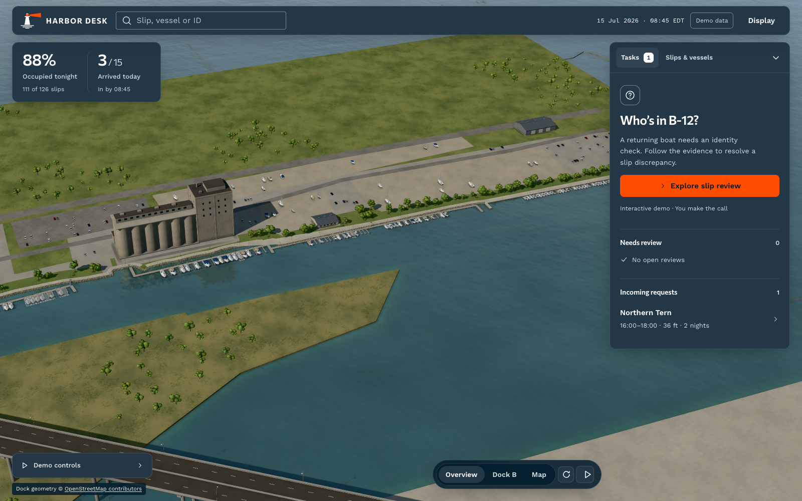

# Harbor Desk — Product Guide

What Harbor Desk is, who it is for, what it does, and how to get the most out of it. For install, build and test instructions see [README.md](README.md).

> **Independent concept.** Harbor Desk is a portfolio experiment by Raj Shah, set at a marina on the Buffalo River in Buffalo, New York. There is no partnership with, endorsement by, or deployment at any marina or operator. Every vessel, booking, observation, photo, staff action and dollar figure is simulated. Slip layout, depths and services are design assumptions. The roles below are product hypotheses, not interview findings.

---

## 1. What it is

Harbor Desk is a **3D slip desk for a marina**: the marina itself is the interface. The docks, every slip, the boats in them and the waterfront around them are on screen, and the records sit beside them: who is assigned where, who has arrived, what needs review.

It is built around one everyday problem: **the marina's records and what is actually in the water disagree.** A dock walk says a slip is occupied, but the boat assigned to it left an hour ago. Is it the same boat back early, a different boat, or a mistake? Harbor Desk turns that into a short, evidence-led review: see the slip, compare the observation with the records, gather staff evidence, then decide. Nothing in the original record is overwritten.

Alongside that review, it shows the rest of a dockmaster's day:

- tonight's occupancy and today's arrivals;
- incoming transient requests, assigned by dragging them onto the map, with each slip's fit checked as you go;
- a lake-conditions what-if, which re-checks that fit for a gale;
- a timeline you can scrub to replay the day.

### The idea it tests

> A marina team resolves slip and vessel discrepancies faster, and with fewer wrong calls, when it can **see the slip in context** and **follow the evidence**, rather than reconcile a spreadsheet, a radio call and a memory.

Three design principles follow from that:

1. **Presence is not identity.** A camera or a dock walk can say *a boat is there*; only checked evidence can say *which boat*. The product never lets the first stand in for the second.
2. **Humans decide; history is never rewritten.** Suggestions (a "possible match") are labelled as such. A person confirms, with a reason, and the original observation stays on the record beside the decision. This is the pattern an AI-assisted marina system would need: the model proposes, staff confirm with evidence.
3. **The map does the list's job too.** The default view is 3D, but the **Map** preset turns it into a top-down dock map, with status plates and slip numbers on all 126 berths. Every action also works from the lists and with the keyboard. The flat 2D plan is the fallback for small screens and low-power devices.

---

## 2. Who it is for

### Operational audience (hypotheses)

The intended setting is a mid-sized seasonal marina: about 126 slips on five docks, a mix of seasonal holders and transient boaters, and a small staff. The roles below are how the design divides the work. The demo has no logins or permissions: anyone can do everything.

| Role | What they need from Harbor Desk | Where it lives |
|---|---|---|
| **Marina owner / general manager** | How full are we tonight, who has arrived, and how much agreement value is tied up in unresolved issues. A read of the business without opening every record. | Overview strip (Occupied tonight, Arrived today). Arrivals view, with vacant slips, unsold nights and **Revenue estimates**. |
| **Dockmaster / harbormaster** (primary persona) | One queue of what needs a decision. Resolve slip discrepancies on evidence. Put incoming boats in slips that actually fit, and know when weather changes that. | **Tasks** (Needs review, Incoming requests), slip review, the request card with drag-to-assign, **Conditions & what-if**. |
| **Dock staff** | Report what they see on dock walks, and carry out identity checks when the office asks. | Their work appears as records: the dock-walk entry, the dock check (requested from the review), and the staff evidence that confirms identity. In this demo the dock check is simulated: **no message is sent**. |
| **Front office / reservations** | Answer "is there a slip for a 36 ft cabin cruiser tonight?" and record the assignment. | Incoming request → slip list ranked by fit, or drag-to-assign on the map; **Undo** if plans change. |

The supporting persona from the original brief is the dock-staff member performing identity checks. The dockmaster is the person the screens are designed around.

### Portfolio audience

Hiring teams evaluating product thinking and 3D prototyping. For them the point is the combination: a real place, rendered well enough to navigate, and an operational workflow with correct rules underneath (presence vs identity, append-only history, read-only replay, keyboard parity).

---

## 3. A tour of the screen

| Area | What it shows |
|---|---|
| **Top bar** | Search (slip ID such as `B-12`, vessel name, or vessel ID), the simulated date and time (15 Jul 2026), **Demo data** (opens About / Sources, which explains every label and source), **Display** (theme, solid panels, small-screen map choice). |
| **Overview strip** (top left) | **Occupied tonight** (percentage and slips) and **Arrived today** (checked in so far, out of today's bookings). Select **Arrived today** to open the arrivals board. |
| **Workspace** (right) | Two tabs: **Tasks** (with a count of unresolved work) and **Slips & vessels** (searchable, filterable lists, plus Arrivals). Selecting a record opens its detail here, and **Back** returns to the list without losing your filters or scroll position. |
| **The marina** (centre) | The 3D scene. Click a slip or boat to open it. Hover for its label. |
| **Camera bar** (bottom centre) | **Overview**, **Dock B**, **Map**; **Reset view**; **Pause motion**. In Map mode a legend shows berth statuses. |
| **Demo controls** (bottom left) | Collapsed by default. **Guided replay**, **Restart demo**, the **Day timeline** scrubber, and the review steps. |

---

## 4. Core functionality

### 4.1 Slip discrepancy review (the main workflow)

The scenario: at **09:10** the morning dock walk marks **B-12** occupied. B-12 is held by agreement for **Lake Effect**, which departed at **08:10**. At 09:12 camera C-02 shows a vessel in the slip, but the camera cannot establish identity.

1. **Open it.** In **Tasks**, choose **Explore slip review** ("Who's in B-12?"). The camera flies to B-12 and the slip detail opens: *Present · Identity unverified*, the assigned vessel, the booking ("Held by agreement") and the camera source.
2. **Read the discrepancy.** The discrepancy review shows the dock-walk entry, the camera still, and **What the camera can establish** (presence, not a name or registration).
3. **Optionally request a dock check.** **Request dock check** logs a task for staff to look at the boat. The slip moves to *Dock check pending*. No message is sent; this demo contacts no one.
4. **Review the observation.** **Review observation** compares what was observed with the registry records: Lake Effect, and Harbor Light as a possible match.
5. **Load the staff evidence.** **Load simulated dock-check result** adds the staff photo and the dock check's notes: name board and registration ending 42 AB, matching Lake Effect. The note explains how the canvas cover changed the boat's look.
6. **Decide.** Tick **I reviewed the staff evidence**, then **Confirm identity & resolve**. Confirmation stays disabled until there is staff evidence *and* the acknowledgment is ticked. Camera evidence alone can never confirm identity.
7. **See what did and did not change.** The resolution shows *Lake Effect confirmed at B-12*, with the identity source, and **Agreement: Unchanged**. **Original observation** keeps the camera record exactly as it was. **Activity history** lists every step with its time.

Two branches are supported: **direct** (review, then resolve) and **pending** (request a dock check first, then resolve). **Back to observation** before confirming clears the acknowledgment and leaves the issue open.

### 4.2 Incoming requests and fit-aware assignment

**Northern Tern** (a 36 ft cabin cruiser, arriving 16:00–18:00 for 2 nights) is in **Tasks → Incoming requests**.

- **By list:** open the request. The **Slip** list holds every offered slip with its verdict, best first: **Fits**, **Tight** or **No fit**. Choose one; the reason is shown (for example "Fits: LOA 36 ft in a 40 ft slip"). **Assign** is enabled for Fits and Tight.
- **By drag:** switch to **Map**, press the request's drag handle (**Or drag onto a slip**) and move over the docks. A chip under the pointer gives the verdict for the slip you are over, and the slip's label gives the reason. Drop on a slip that fits; anywhere else does nothing, and **Escape** cancels.
- **What happens:** the boat sails in along a path from the river mouth (it never teleports), and the request shows *Assigned to D-01 · demo assignment*. **Undo** sends it back out and stamps the record undone, without deleting it.
- **What "fit" means here:** length and beam against the slip, draft against water depth, and shore power. Slip depths and services are **assumptions** (labelled ASSUME), so the card says to verify before a real assignment. Slips held by agreement, B-12 included, are never offered.

### 4.3 Conditions & what-if (lake weather)

Inside a request, **Conditions & what-if** switches between **Calm** and **SW gale**. It is a lens, not a record: it never changes your run.

- **Calm** gives the normal verdicts.
- **SW gale** applies a simulated Lake Erie event. A south-west gale piles water up at Buffalo through the morning, then the lake sloshes back (a *seiche*) to **1.5 ft below still water at 18:45**, during Northern Tern's stay. The fit check then uses:
  - the stay's **lowest water** for draft;
  - its **highest water** against fixed docks A and E;
  - its strongest **onshore wind** for the open river-mouth berths (Dock A and B-01…B-19): tight from 20 kt, no fit from 34 kt, the National Weather Service gale threshold.
- **Result:** of 15 offered slips, only D-01 still works, and it is tight ("1 ft under the keel at the 18:45 low").
- **In the scene:** the water shows downwind ripples and whitecaps, and the sky goes overcast. The strip chart shows the level through the stay.
- **After assigning:** if an assignment made under one condition gets worse under the other, the request flags it; it does not change it.

The seiche period and amplitudes are demo values (ASSUME); only the gale wind band is a cited figure.

### 4.4 The day timeline (replay)

Open **Demo controls** and drag the **Day timeline**, or focus it and use the arrow keys, Home and End. It runs from 06:00 to 22:00.

- The scene, the overview strip and the arrivals board all follow the time. Boats leave and return, check-ins appear, camera sweeps refresh, and daylight changes.
- Scrubbing is **read-only**. The panel says *Replay · Read-only*, actions are hidden, and the future never leaks backward.
- **Return to my run** takes you back to exactly where you were.
- **Guided replay** jumps between the scripted review stages. **Try this state** starts a new interactive run from a stage, and says that it replaces your current run.

### 4.5 Registry: slips and vessels

**Slips & vessels** lists all 126 slips and every vessel. You can:

- search by slip ID, vessel name or ID;
- filter by **Dock** and **Needs review**;
- open any record.

A slip shows presence, the assigned vessel and booking eligibility once each. An empty slip is never shown as bookable by implication: *Availability not assessed* is a distinct state. A vessel shows its assignment, particulars, identifiers and simulated document review. Deep links work too: `?select=B-12` or `?select=V-021`.

### 4.6 Arrivals and revenue estimates

Select **Arrived today** (or the Arrivals list) for today's board:

- check-in progress;
- each check-in, return from an outing and demo assignment, with its slip and time;
- **Vacant tonight** and **Unsold · next nights**.

**Revenue estimates** gives the nightly agreement value and the **value under review**. That is the full term value of agreements linked to open issues; it is not a forecast of lost revenue. Rates are illustrative.

---

## 5. How to use it for the best experience

**Recommended path (about 3 minutes).** On a laptop or desktop:

1. **Watch the opening.** It starts on a still of the whole marina and flies in to Dock B. Click, scroll or press a key to skip.
2. **Resolve B-12.** In **Tasks**, choose **Explore slip review** and follow 4.1, once directly. Then use **Restart demo** (in Demo controls) and take the **Request dock check** branch.
3. **Assign Northern Tern by drag.** Switch to **Map**, drag the request over A-01 (no fit), then onto D-01 (fits), and watch it sail in. Try **Undo**.
4. **Turn on the gale.** Open **Conditions & what-if**, choose **SW gale**, and look at how the slip list changes. Switch to **Overview** to see the weather on the water.
5. **Scrub the day.** Open **Demo controls**, drag the timeline to the evening and back, then **Return to my run**.

**Best setup**
- A desktop browser at 1280 px or wider. Chrome or Edge gives the full look; Safari and Firefox have not been verified. Tablet works with a narrower workspace. Phones get the dock map, or the 2D plan on low-power devices, under a bottom sheet.
- A dedicated GPU or Apple silicon gets the full rendering tier (reflections, ambient occlusion, detailed trees). Software or low-power renderers get a lighter tier automatically.
- **Display** has light and dark themes and **solid panels**, which are more legible over a busy scene.

**Getting around**
- **Mouse:** drag to orbit, right-drag to pan, scroll to zoom; click a slip or boat to open it.
- **Keyboard:** Tab through every control. With the map focused, **arrow keys pan**. Lists use the arrow keys, Home, End and Enter. **Escape** cancels a drag or closes a menu.
- **Touch:** one finger to orbit, two to pan and zoom. The map's touch behaviour is untested on real devices.
- **Motion:** **Pause motion** stops the water, traffic and camera flights, and your system's *reduce motion* setting is honoured automatically.

**Tips**
- Your run is saved in this browser (localStorage). Reload and it is still there. **Restart demo** returns to 08:45 with nothing resolved. If storage is unavailable, the run lasts for the tab and the app says so.
- `?lake=sw-gale` opens with the gale what-if on, and `?select=B-12` opens a slip.
- **Demo data** explains every label:
  - **DOC**: a documented source;
  - **ASSUME**: a design assumption;
  - **SIM**: simulated;
  - **FIELD**: needs checking on site.
- If the 3D view fails, Harbor Desk falls back to the 2D plan with the same records and workflow.

---

## 6. What it is not

Not a booking system, a navigation or survey tool, or a camera integration. It has no payments, messages, logins or real data. There is no working recognition model: "possible matches" are scripted. A real pilot would need:

- operator research and consent;
- a surveyed slip plan and current service checks;
- authorized vessel and agreement records;
- a camera placement and privacy review;
- measured recognition error rates;
- secure access, retention rules and a shared audit trail.

None of this has been done. See **Demo data → What a real pilot would require** in the app, and [PRD.md](PRD.md) §13–14.

## 7. Further reading

- [README.md](README.md): install, run, test, architecture, deployment.
- [PRD.md](PRD.md): requirements, scenario rules and state invariants.
- [DESIGN.md](DESIGN.md): design system and the 16 Nov workspace refinement (§17).
- [showcase/CASE-STUDY.md](showcase/CASE-STUDY.md): the portfolio write-up.
- [QA.md](QA.md) and [BUILD-LOG.md](BUILD-LOG.md): what was tested and measured, and what was not.
