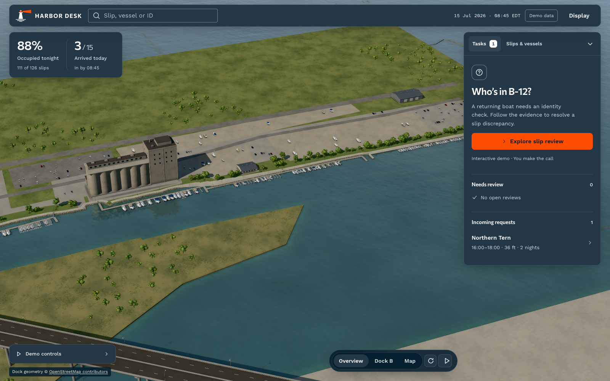

# Harbor Desk

A 3D slip desk for a Buffalo River marina: an independent portfolio concept by Raj Shah. The marina is the interface. Resolve a slip discrepancy on evidence, assign an incoming boat by dragging it onto a slip that fits, re-check that fit for a lake gale, and scrub the day back and forth.

> Everything here is **simulated or assumed**. There is no partnership with, or deployment at, any marina. Vessels, bookings, observations, evidence, staff actions and figures are fictional. Slip layout, depths and services are design assumptions. Dock geometry © OpenStreetMap contributors (ODbL).

**[Open the live demo](https://harbor-desk-buffalo-rssdesign.vercel.app)**: best on a desktop browser at 1280 px or wider.

- **What it is and how to use it:** [PRODUCT-GUIDE.md](PRODUCT-GUIDE.md), covering users and roles, core functionality and the recommended path.
- **Portfolio package:** [showcase/](showcase/README.md), with the walkthrough video, card loop, stills, case-study copy and the experiments-page card.



---

## Requirements

- **Node.js 24.** `package.json` pins `24.x`, the runtime the production build was validated on. The scripts are TypeScript run directly by Node's type stripping, with no `ts-node`.
- npm 10+.
- A Chromium browser for the browser tests: `npx playwright install chromium`.
- `ffmpeg` on PATH, only to re-record the showcase video.

Nothing calls the network at runtime: no API keys, no remote fonts, no map tiles, no CDN decoders. A browser test fails if the app makes any non-local request.

## Install and run

```bash
npm ci
```

```bash
npm run dev
```

The dev server opens at http://localhost:5173. Vite listens on `localhost`, not `127.0.0.1`.

Production build and local preview:

```bash
npm run build
```

```bash
npm run preview
```

The preview serves `dist/` at http://127.0.0.1:4719. The port is dedicated and strict, so another project's preview can never be tested by mistake.

## Test

| Command | What it runs |
|---|---|
| `npm run check` | The full gate: token, fixture and asset drift checks; typecheck; lint; 240 unit tests (vitest); production build. |
| `npm test` | Unit tests only: domain engine, fit, lake, timeline, persistence, validation, selectors. |
| `npm run test:e2e -- --workers=1` | Browser journeys (Playwright, Chromium). It builds, starts its own preview on 4719, and fails if that port is taken. **Stop any preview on 4719 first.** Use one worker: parallel workers time out on software WebGL. |
| `npm run fixtures:check` | Regenerates fixtures in memory and fails if `data/fixtures/` drifted. |

Notes:

- The browser journeys run headless on SwiftShader, so they exercise the **lite** rendering tier. Performance and look are checked separately on a real GPU with the `--gpu` scripts below.
- `tests/e2e/zoom.spec.ts` opens a real 200% browser zoom in a visible window. It checks the CSS viewport against the window, so it passes on standard and Retina displays.
- `release.spec.ts` (GPU picking) and `zoom.spec.ts` open visible browser windows while they run.

## Using the demo

The full user guide is [PRODUCT-GUIDE.md](PRODUCT-GUIDE.md). In short:

- **Main workflow:** **Tasks → Explore slip review** opens the B-12 discrepancy. Then **Review observation → Load simulated dock-check result → I reviewed the staff evidence → Confirm identity & resolve**. The other branch adds **Request dock check** first.
- **Assignment:** **Tasks → Northern Tern** opens the request. Choose a slip from the list ranked by fit, or switch to **Map** and drag the request's handle onto a slip. **Undo** reverses it, keeping the record.
- **What-if:** inside the request, **Conditions & what-if → SW gale** re-checks fit for a simulated seiche and gale. It never changes the run.
- **Replay:** **Demo controls** holds the **Day timeline**, a read-only scrub from 06:00 to 22:00. **Return to my run** brings you back. **Guided replay** jumps between the scripted stages; **Try this state** starts a new run from one.
- **Reset:** **Demo controls → Restart demo** returns to 08:45 with nothing resolved or assigned.

**Controls**

| Input | Action |
|---|---|
| Mouse | Drag to orbit, right-drag to pan, scroll to zoom. Click a slip or boat to open it. |
| Keyboard | Tab through every control. With the map focused, arrow keys pan. Lists use arrows, Home, End and Enter. Escape cancels a drag or closes a menu. The slider uses arrows, Home and End. |
| Camera bar | **Overview**, **Dock B** (the resting view; **Reset view** returns here), **Map** (top-down dock map with status plates), **Pause motion**. |
| Display | Dark or light theme; solid panels; on small screens, 3D map or 2D plan. |

The OS *reduce motion* setting is honoured: no camera flights, still water, no opening move.

**URL options**

| Parameter | Effect |
|---|---|
| `?select=B-12` / `?select=V-021` | Opens that slip or vessel. Unknown IDs show a recoverable notice. |
| `?lake=sw-gale` | Starts with the gale what-if on. |
| `?debug` | Exposes `window.__harborDesk` (store) and `window.__harborScene` (camera, projection, stats) for tests and scripts. |
| `?debug&fault=…` | Fault injection, for example `geometry`, `model`, `evidence`, `webgl-unsupported` or `storage-corrupt`. See `src/app/faults.ts`. Ignored without `debug`. |
| `?debug&gpu=capable\|low` | Forces the full or lite rendering tier. |
| `?ui=primitives` | Gallery of the UI primitives. |

## Local persistence

The interactive run is saved in `localStorage` under `harbor-desk:session`, with a schema and scenario version. Display preferences are kept separately under `harbor-desk:prefs`.

- A corrupt, older or inconsistent saved run is discarded, and the app says it started fresh.
- If storage is unavailable or full, the run lasts for the tab and a notice says so.
- Replay and the lake what-if are view state: they are never saved into, or able to change, the run.

To clear everything, run **Restart demo**, or remove both keys in DevTools.

## Architecture

```
src/
  domain/    Pure, deterministic rules. No React, no three.js.
             engine.ts      apply(fixtures, session, command) → new session (the only way state changes)
             session.ts     DemoSession; append-only issues, decisions, audit; assignments with undoneAt
             fit.ts         Fits / Tight / No fit per slip, with reasons (LOA, beam, draft vs depth, power)
             lake.ts        lake what-if: level and wind at a time, stay extremes
             timeline.ts    projectSession(run, t): the scripted day at any minute (read-only replay)
             replay.ts      guided checkpoints
             selectors.ts   memoised read models (occupancy, map statuses, arrivals, summaries)
             validate.ts    fixture validation and quarantine; persistence.ts versioned save/load
             store.ts       app store: interactive run + view state (replay, lake, selection)
  data/      Deterministic fixture generator (seeded PRNG) and site geometry assembly
  app/       Shell, layout modes (desktop ≥1280, tablet 768–1279, mobile), prefs, error boundaries, faults
  features/  registry (tasks, lists, inspector), slip-review, assign (request card, lake what-if),
             board (arrivals), demo-controls (replay, day scrubber), plan (2D fallback), view, about
  scene/     React Three Fiber scene: camera rig and presets, water (ripples, planar reflection, wind),
             sky and daylight, screen-space AO, dock map layer, boats and traffic, picking, keyboard pan.
             assets/ are TypeScript generators: boats, docks, trees and buildings are authored in code; no GLB ships.
  ui/        Tokens (generated), primitives, icons, announcer (live region)
data/
  fixtures/  Generated SIM/ASSUME records (vessels, agreements, observations, movements, lake series…)
  derived/   Generated site geometry and reports
  slips.geojson, buffalo-river-features.geojson   Supplied/OSM-derived inputs
design/      Brand, tokens (source of truth for src/ui/tokens.css), fonts, visual targets, storyboard
scripts/     Generators, QA captures, measurements, showcase recording
tests/       unit/ (vitest), e2e/ (Playwright)
```

Main decisions:

- **One way to change state.** Every action is a command to the pure engine, so the same rules hold for the keyboard, the mouse, drag, replay branches and tests.
- **Separate concepts.** Presence, identity, agreement, document review and availability are kept apart. Decisions are appended; the original observation is never edited.
- **Code splitting.** The 3D scene (three.js, Drei) is a lazily loaded chunk. The shell paints first, from a poster rendered from the scene itself, which then fades onto the first live frame.
- **Two rendering tiers.** The full tier (planar reflection, AO, 4096² shadows, detailed foliage) runs on capable GPUs. The lite tier runs on software and low-power renderers. If WebGL fails, the 2D plan takes over with the same records.

## Regenerating data and assets

| Command | Regenerates |
|---|---|
| `npm run fixtures` | `data/fixtures/*.json` from `src/data/generate.ts`. The output is deterministic and byte-stable. |
| `npm run tokens` | `src/ui/tokens.css` from `design/tokens.json`. |
| `npm run geometry` | Site geometry checks, the annotated plan and `data/derived/site-runtime.json`. |
| `npm run assets` / `npm run assets:glb` | The asset report, and an optional GLB export of the generated models for inspection. Nothing is shipped from it. |
| `node scripts/render-poster.ts --gpu` | `public/assets/poster/*` (the opening still). Needs `npm run preview`. |
| `node scripts/render-evidence.ts --gpu` | `public/assets/evidence/*` (the simulated camera and staff stills). Needs `npm run preview`. |
| `node scripts/capture-showcase.ts --gpu` | `showcase/stills/*` (1600×1000 and @2x). |
| `node scripts/record-walkthrough.ts --gpu [--take card]` | `showcase/video/*` (the walkthrough and the card loop; needs ffmpeg). |
| `npm run profile` / `npm run transfer` | Frame pacing and transfer-size measurements (QA). |

`--gpu` launches headless Chromium on the real GPU through Metal (`--use-angle=metal`, macOS). Without it you get software rendering and the lite tier. After any change to the scene's look, re-render the poster and evidence stills.

## Deployment

The app is a static site: `npm run build` → `dist/`. There are no environment variables, server functions or secrets.

| | |
|---|---|
| Live | https://harbor-desk-buffalo-rssdesign.vercel.app |
| Repository | [RSSDesign9/harbor-desk-buffalo](https://github.com/RSSDesign9/harbor-desk-buffalo) (public) |
| Vercel project | `harbor-desk-buffalo-rssdesign`: framework Vite, install `npm ci`, build `npm run build`, output `dist`, Node 24 ([vercel.json](vercel.json)) |

- **History.** The standalone repository begins with the app snapshot from local commit `b2dc232d`. Later work is applied on top of it.
- **Upload filter.** [.vercelignore](.vercelignore) keeps `qa/`, `design/`, `data/reference/`, `showcase/`, the Markdown documents and videos out of the build upload.
- **Domain root only.** Host at a domain root, not under a sub-path such as `/experiments/harbor-desk`. Asset and font URLs are absolute (`/assets`, `/fonts`); a sub-path would need `base` set in `vite.config.ts`.
- **What ships:** only `public/` and modules imported from `src/`. Source maps are emitted. Authoring material (`design/`, `data/reference/`, the reference video, `showcase/`, `qa/`) never ships.

## Provenance and labels

Each record carries a provenance label. Sources are listed in [REFERENCES.md](REFERENCES.md) and in the app.

- **DOC:** documented source, with link and date.
- **ASSUME:** design assumption.
- **SIM:** simulated.
- **FIELD:** needs checking on site.

The app's **Demo data** button opens About / Sources, which lists every source and caveat. Key facts:

- **Geometry:** the docks sit on the **west bank of the City Ship Canal at the Buffalo River mouth**, from OpenStreetMap ways checked against a dated 2022 ESD site map (`data/GEOMETRY-VALIDATION.md`). The 126-slip plan (A–E) is an assumption (`data/SLIPS.md`, `data/SITE-NOTES.md`).
- **The scenario:** 15 July 2026, B-12 and Lake Effect. It is fictional and generated deterministically.
- **Lake data:** the gale band (34–47 kt) is cited from the NWS Great Lakes marine guide. The seiche period and amplitudes are demo values.

## Known limitations

- **Unverified:**
  - performance on an M1 MacBook Air (everything was measured on an M3 Max);
  - a spoken screen-reader pass;
  - physical touch;
  - Safari and Firefox.
- **Browser tests** cover the lite rendering tier; the full tier is checked with GPU captures and profiles.
- **The scene doesn't show the gale's water level rising or falling**; the request card charts it.
- **Not modelled:** the downtown skyline and the elevator's marine tower (no sourced positions), and fenders.
- **No user research:** there is no operator feedback or usability study. The five-person comprehension test in PRD §12 is still optional and not run.
- **Not built:** real integrations, payments, messaging, logins, camera feeds or recognition.

## Project documents

| Document | Purpose |
|---|---|
| [PRODUCT-GUIDE.md](PRODUCT-GUIDE.md) | What it is, who it is for, features, how to use it |
| [PRD.md](PRD.md) | Requirements, scenario, state invariants, quality targets (v1.1 §15) |
| [TASKS.md](TASKS.md) | Build checklist T01–T35 with completion evidence |
| [BUILD-LOG.md](BUILD-LOG.md) | What was built, checked and left open, task by task |
| [QA.md](QA.md) | Gate C and Gate D results, measurements, screenshots |
| [DESIGN.md](DESIGN.md) · [design/tokens.json](design/tokens.json) | Design system, type, colour, the 16 Nov workspace refinement |
| [PRODUCT.md](PRODUCT.md) · [REFERENCES.md](REFERENCES.md) | Product context and decisions; sources |
| [IMPROVEMENT-PLAN.md](IMPROVEMENT-PLAN.md) · [DOCKWA-ANALYSIS.md](DOCKWA-ANALYSIS.md) | v1.1 rationale (local, not for publication) |
| [data/GEOMETRY-VALIDATION.md](data/GEOMETRY-VALIDATION.md) · [data/SITE-NOTES.md](data/SITE-NOTES.md) · [data/SLIPS.md](data/SLIPS.md) | Geography sources and caveats |
| [showcase/](showcase/README.md) | Portfolio media and copy |

## Licence and credits

The code and authored assets are © Raj Shah, all rights reserved; no open-source licence has been chosen.

- **Fonts:** Commissioner, Work Sans and Atkinson Hyperlegible Mono, under the SIL Open Font License (`public/fonts/`).
- **Third-party software:** credited in `public/THIRD-PARTY-NOTICES.txt`.
- **Map data:** © OpenStreetMap contributors, ODbL.
