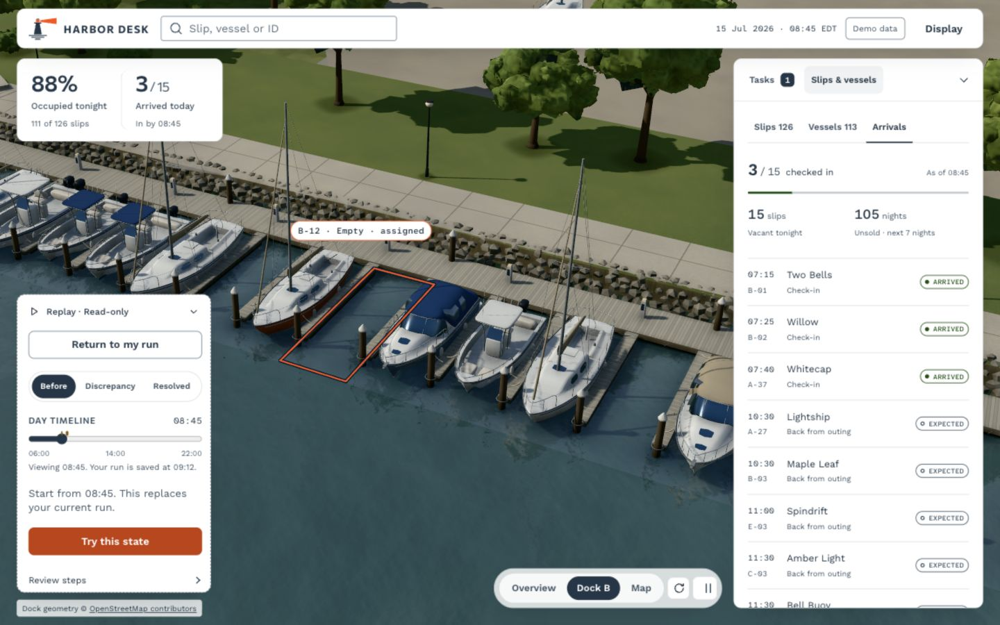

# Harbor Desk · Buffalo River

A map-first marina operations concept. Explore a 3D Buffalo River marina, investigate a slip discrepancy, compare camera observations with staff evidence, and resolve the issue without confusing vessel presence with booking availability.

**[Open the live demo](https://harbor-desk-buffalo-rssdesign.vercel.app)**



## Try the workflow

1. Choose **Explore slip review** to investigate Slip B-12.
2. Review the observation and request a simulated dock check.
3. Compare the staff evidence, acknowledge it, and confirm the vessel identity.
4. Browse slips, vessels and arrivals, or explore an incoming request and lake-condition scenarios.

The map supports mouse navigation and arrow-key panning when focused. Display options include light and dark themes, reduced motion and a 2D fallback. Guided replay is read-only and preserves your interactive run.

## Run locally

Requires Node.js 24 and npm.

```sh
npm ci
npm run dev
```

```sh
npm run check      # Tokens, fixtures, assets, types, lint, unit tests and production build
npm run test:e2e   # Playwright browser journeys
npm run build     # Static production output in dist/
```

Browser tests require Playwright Chromium: `npx playwright install chromium`.

## Stack and deployment

React, TypeScript, Vite, Three.js, React Three Fiber and Drei. The application is static and stores the interactive demo locally in the browser. No backend, credentials or external API keys are required.

Vercel builds with `npm ci` and `npm run build`, then publishes `dist/`. The production project is `harbor-desk-buffalo-rssdesign`.

## About the concept

This is an independent portfolio concept, not a deployed marina management system. Vessels, observations, staff evidence and operations are fictional. Slip dimensions and services are assumptions. Geography draws on documented references; the application’s **Demo data** disclosure and [REFERENCES.md](REFERENCES.md) explain sources and limitations. It is not a navigation tool.

Design rationale, implementation notes and visual QA are retained in this repository. See [DESIGN.md](DESIGN.md), [PRODUCT.md](PRODUCT.md) and [QA.md](QA.md). This standalone repository begins with the app snapshot from local commit `b2dc232d`.
