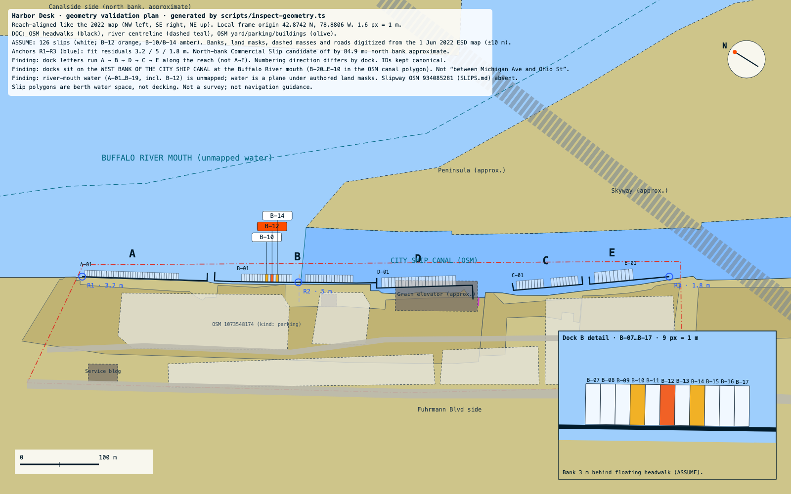

# Geometry validation and local coordinate system

Written 14 November 2026 for TASKS T02. Reproduce with `npm run geometry`. Original inputs are read only; every correction is a derived file under [derived/](derived/).

[Annotated plan (SVG)](derived/site-plan-annotated.svg) · [Check results](derived/geometry-report.json) · [Derived local geometry](derived/site-local.json) · Generator: [scripts/inspect-geometry.ts](../scripts/inspect-geometry.ts), rasterized by [scripts/render-plan.ts](../scripts/render-plan.ts)

## Summary

- The supplied OSM headwalks and the 126 generated slips line up with the **1 June 2022 official site map** within a few metres at three distributed dock anchors. The marina layout can be built on them, labelled approximate.
- The docks sit on the **west bank of the City Ship Canal, where it opens into the Buffalo River mouth**, with the Skyway at the upstream (south-east) end. They are not “between the Michigan Avenue and Ohio Street bridges” (SLIPS.md); SITE-NOTES was right to doubt that. B-20…E-10 lie inside OSM’s “City Ship Canal” water polygon; A-01…B-19, including B-12, face the river mouth.
- Slip geometry is internally sound: closed rectangles, correct sizes in feet, no overlaps, all attached to their headwalks, all opening into water.
- Four source findings remain open and are recorded, not silently fixed: dock letters run A, B, **D, C**, E along the reach; numbering direction differs on Dock E; the slipway SLIPS.md cites is absent; river-mouth water is unmapped.
- The environment must stay labelled **approximate**. North-bank context could not be anchored independently.

## Sources

| Source | Date | Status | Use |
|---|---|---|---|
| [buffalo-river-features.geojson](buffalo-river-features.geojson) (OSM, ODbL) | fetched 14 Nov 2026 | DOC — documented source, not a current survey | Headwalks, river centreline, City Ship Canal, yard/parking, buildings |
| [slips.geojson](slips.geojson) | generated 14 Nov 2026 | ASSUME | 126 berth polygons, IDs canonical |
| [Official site map](reference/first-buffalo-site-map-2022.pdf) ([ESD](https://www.esd.ny.gov/sites/default/files/rfp/Exhibit-A-Site-Map-First-Buffalo-Marina-Operator.pdf)) | 1 Jun 2022 | DOC — dated diagram on an aerial photo | Alignment anchors; approximate placement of masses, roads, the Skyway, the site boundary |

## Local metric frame

| Item | Value |
|---|---|
| Origin | 42.8742 N, 78.8806 W (WGS84), a rounded point beside B-12; not a surveyed control point |
| Units | metres; feet → metres at exactly 0.3048 at the scene boundary; feet stay in the UI |
| Horizontal axes | `east` (+), `north` (+) |
| Scene axes (three.js, Y up) | x = east, y = up, z = −north |
| Vertical | y = 0 is the water surface; no vertical datum or depths are modelled |
| Projection | Local tangent plane: Δlon·N·cos φ₀ and Δlat·M, with the WGS84 prime-vertical (N) and meridian (M) radii at φ₀. Round-trip error < 1 mm; approximation error a few cm over the 1.5 km working area. Implemented once in [src/scene/geo.ts](../src/scene/geo.ts) and unit-tested |
| Slip bounds | east −128.1 … 245.8 m, north −390.3 … 204.8 m (≈ 700 m of frontage along a bearing of ≈148°) |
| B-12 | centroid (−4.9 E, −1.3 N) m; opens toward bearing 59° (NE); 0.6 m from its headwalk |
| North | True north. On the 2022 map, “up” points to bearing ≈59° (NE); the plan is drawn the same way with a north arrow |

## Anchors against the 2022 map

The PDF was rendered at 2400 × 1553 px (`sips -s format png -Z 2400`). Points were picked by eye (≈ ±10 px ≈ ±6 m) and fitted with a least-squares similarity transform (1.63 px/m).

| Anchor | Local feature | Map feature (px) | Residual |
|---|---|---|---|
| R1 (NW) | Dock A headwalk start, OSM 934085283 | Headwalk at the site-boundary corner, marker 2 (640, 657.5) | 3.2 m |
| R2 (centre) | Gap between Dock B’s two runs, OSM 934085288 | Gangway at marker 5 (1075, 657.5) | 5.0 m |
| R3 (SE) | Dock E headwalk end, OSM 1073532822 | End of the dock line in the Skyway shadow, marker 10 (1850, 643.5) | 1.8 m |

Independent checks, not used in the fit:

| Check | Result |
|---|---|
| C1: mid-river between the Canalside wharf edge and the dock line on the map, compared with the OSM river centreline | 17.9 m apart: consistent at river scale |
| C2: a candidate Commercial Slip mouth on the map compared with OSM 371587071 | 84.9 m apart: **unresolved**. The channel on the map may be a different feature, or the aerial is not orthographic at that distance. North-bank massing stays approximate and must not be placed precisely from this fit |

All three anchors lie along one shoreline, so the fit constrains scale and rotation along the reach better than the perpendicular. C1 gives some perpendicular confidence. This is not survey accuracy.

## Check results

27 checks; 23 pass, 4 flag genuine source findings. Full detail in [geometry-report.json](derived/geometry-report.json).

| Check | Result |
|---|---|
| OSM feature count / provenance | 146 features, all DOC |
| Slip count, per dock | 126: A 39, B 37, C 18, D 22, E 10 |
| IDs | unique; `X-NN` matches dock/number; numbers contiguous per dock; B-10/B-12/B-14 present |
| Ring closure, finite coordinates, 4 corners | all 126 pass |
| Units and dimensions | polygon sizes match `length_ft`/`width_ft` within 0.38%; corners square within 0.51° |
| Headwalk attachment | every inner edge within 0.6 m of its OSM headwalk |
| Overlap | no overlapping pairs |
| Spacing | centre spacing equals slip width; B and C have one run break each (20.3 m and 13.3 m), where gangways sit |
| Land intersection | no slip overlaps a mapped yard, parking or building polygon, or an authored land mask |
| Water side | every slip opens away from the bank into water |
| Yard vs bank | all 50 vertices of OSM 1073548174 on the land side (±1 m) |
| Water repair | City Ship Canal 0% covered by land; river centreline never under land; other mapped water cut out as holes |
| **FLAG** Slipway 934085281 | cited by SLIPS.md, absent from the supplied file. The only slipway present is OSM 1073540134, between Docks D and C |
| **FLAG** Water coverage | 68 slips in the City Ship Canal polygon; 58 (A-01…B-19, incl. B-12) in river-mouth water mapped only as a centreline |
| **FLAG** Dock order | along the reach the generated letters run A → B → **D → C** → E, contrary to SLIPS.md’s rule. IDs stay canonical (PRD §3) |
| **FLAG** Numbering direction | 01 is at the north-west end on A–D but at the south-east end on E |

Informational: OSM headwalk lengths do not match SLIPS.md’s stated lengths (A 168 m vs “410 ft”, D 152 m vs “349 ft”, E 111 m vs “203 ft”). Slips occupy only part of each run (e.g. E’s 10 slips span 49 m of a 101 m run). Nothing depends on the SLIPS.md figures.

## Slip polygons are water, not decking

Each slip is a berth rectangle that starts at the headwalk line and extends 7.6–13.7 m into water. It is the space a boat occupies, not a walking surface. Headwalks (OSM lines) and finger piers are built separately in the scene: fingers run along one long side of each slip, so berth outlines, decks and gangways can be checked independently. OSM headwalk lines carry no width; deck width is an asset assumption (T03).

## Water repair strategy

The supplied water polygons are partial. No river polygon covers the mouth; the City Ship Canal polygon stops at a closing line across its own mouth.

Adopted approach, recorded in `site-local.json`:

1. **Water is a plane at sea level.** Nothing is “filled”, so an incomplete polygon can never flood the yard.
2. **Land is drawn only where there is evidence**, as three masks (all ASSUME):
   - `land-west` (marina side). North of the canal mouth: bank authored 1 m behind Dock A’s fixed wall and 3 m behind Dock B’s first floating run, inside the yard polygon’s edge. South-east of the mouth: the canal polygon’s DOC west edge, which shares vertices with the yard polygon.
   - `land-east`, the peninsula between the canal and the river. Its canal side is the DOC east edge; its river side is assumed 45 m from the OSM centreline (river width not sourced).
   - `land-north` (Canalside). Wharf edge digitized from the 2022 map; ≈296 m across the mouth from B-12.
3. **Documented water always cuts authored land.** Any mapped water polygon that touches a mask is stored as a hole in it (outer-harbour water 1073603319, Canalside basins 371587071 / 449798165 / 1072510134, and 158778752).

## Intended surrounding masses

Digitized from the 2022 map through the anchor fit. All are ASSUME (±10 m). The site’s own labels support their existence in 2022, not their current state or use.

| ID | What the map shows | Notes |
|---|---|---|
| `grain-elevator` | Marker 7, “Grain Elevator Light Display”, on the shore behind Dock D | Inside the 2022 site boundary. This is the site’s own elevator, **not** the RiverWorks painted silos (PRD §9). Height not sourced |
| `service-building` | Marker 3, near Fuhrmann Blvd at the north-west end | Use not verified |
| `small-building` | Small building by storage area 6 | Use not verified |
| `storage-4a`, `storage-4b`, `storage-6` | Hauled-out boat storage areas | Seasonal storage plausible, not verified |
| `parking-8`, `yard-9` | Parking and an open yard at the south-east end | |
| `site-boundary-2022` | Red dash-dot boundary | Not a parcel boundary |
| `skyway` (line) | NY-5 Skyway crossing the canal at the south-east end, ≈28 m deck | Approximate placement and width |
| `fuhrmann-blvd`, `service-road` (lines) | Roads | Approximate |
| `gangway-marker-5` | Gangway between Dock B’s runs | Matches the B run break (anchor R2) |
| `canalside-wharf-edge` | North bank of the river mouth | Feeds `land-north`; approximate (see C2) |

Not modelled: travel lift, fuel, pump-out and launches (FIELD; the 2022 legend is a dated label, not current service), depths, and the Naval Park vessels (unsourced geometry). Any future addition needs its own source or an explicit approximate label.

## Source-to-derived mapping

| Derived field (`site-local.json`) | From | Transform |
|---|---|---|
| `slips[*]` top-level fields | `slips.geojson` properties | Copied unchanged |
| `slips[*].derived.*` | `slips.geojson` geometry + headwalk | Projected to the local frame; inner/outer edges, heading, measured sizes, chainage |
| `headwalks`, `river.centreline`, `cityShipCanal`, `osmContext`, `slipway` | OSM features | Projected; river ways chained mouth → upstream |
| `landMasks` | OSM headwalks/canal/centreline + 2022 map | Authored as above (ASSUME) |
| `masses`, `lines`, `mapFit` | 2022 map picks | Inverse similarity transform (ASSUME) |

## Limitations

- Not a survey. OSM is crowd-sourced; floating docks move; the map is a 2022 aerial diagram.
- The site’s identity as First Buffalo River Marina rests on location and the official map, not on a record of current operations.
- River width, bank positions north of the canal mouth, building heights, and all north-bank context are assumptions.
- Dock lettering and numbering are generated assumptions with the inconsistencies listed above. Do not present them as the marina’s scheme.

## Batch 6 findings (T14–T15, 14 November 2026)

The supplied inputs and `data/derived/*` are unchanged; `npm run geometry` reproduces them byte for byte (27 checks, same 23 pass / 4 flags). The findings below are corrections and rules applied in code, each with a unit test (`tests/unit/marina-layout.test.ts`, `tests/unit/surroundings.test.ts`).

| Finding | Evidence | What the build does |
|---|---|---|
| **The digitized grain-elevator footprint overhangs documented water.** Its two water-side corners lie 17.1 m and 17.4 m beyond the City Ship Canal edge (DOC, OSM), across Dock D’s headwalk | `masses.grain-elevator` vs `land-west`; found by the new “corners on land” test. The outline was picked from a non-orthographic aerial at roof level, so a tall building leans toward the water in it | Documented water wins. The footprint is moved straight inland, unreshaped, until every corner is at least 6 m behind the bank: **27 m** (`ELEVATOR_INLAND_SHIFT_M` in `src/scene/surroundings.ts`). This exceeds the ±10 m stated for the masses, so the elevator’s position is **approximate**, more so than the other masses. `site-local.json` keeps the original pick |
| Dock E’s berth rings wind the opposite way to A–D | Consistent with the numbering-direction flag above | No geometry change. The berth mesh is drawn and picked double-sided; a browser test clicks berths on all five docks |
| Dock D’s OSM headwalk ends on land | Its last vertex is inside `land-west` | The ramp runs along that last segment from where it crosses the bank; no separate gangway is invented |
| Fixed docks A and E | `kind: fixed`; bank 1.0 m behind A’s line, 3.7–7.5 m behind E’s | Built as a concrete quay apron from the headwalk line back to the bank, with floating finger piers (ASSUME). No gangway |
| Floating docks C and D have no mapped gangway | Only marker 5 (Dock B) is on the 2022 map | One short ramp each where the headwalk comes closest to the bank (ASSUME) |

**Rules the surroundings follow**

- Buildings stand only on the three footprints the 2022 map shows (elevator, service building, small building). Heights are not sourced (bins 30 m, workhouse 45 m, sheds 6.5 / 3.4 m to the eave: ASSUME).
- Stored boats stand only inside `storage-4a`, `storage-4b` and `storage-6`, at least 22 m from the bank and clear of buildings and roads. 24 boats: a sparse summer yard. Scenery, never records.
- The bank walk, verge, rock, lamps and trees follow the `land-west` bank from north-west of Dock A to south-east of Dock E. Painted strips are checked vertex by vertex to lie on land and off buildings.
- The Skyway is the mapped `skyway` line at the mapped 28 m width; its 30 m deck height and 58 m pier spacing are ASSUME.
- The peninsula (`land-east`) and the north bank (`land-north`) are plain ground in two muted tones. Nothing is placed on them: check C2 leaves the north bank unanchored, and no source gives the peninsula’s buildings.
- Still not modelled, for the reasons above: travel lift, fuel, pump-out, launches, depths, Naval Park vessels, the lighthouse and Coast Guard station (the OSM station polygon lies largely outside the authored land mask and is not drawn), and any painted or branded silo.
- North-west of Dock A the authored land mask ends on a straight line that is not a real shoreline. It is at the edge of the overview and stays as authored.
